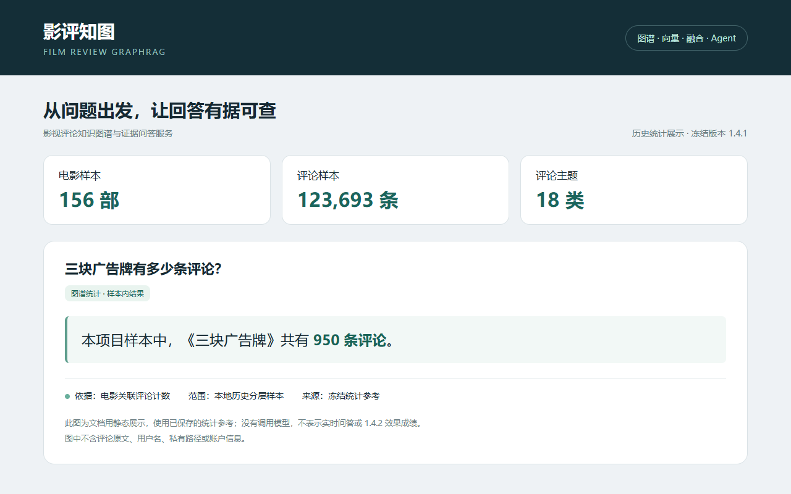
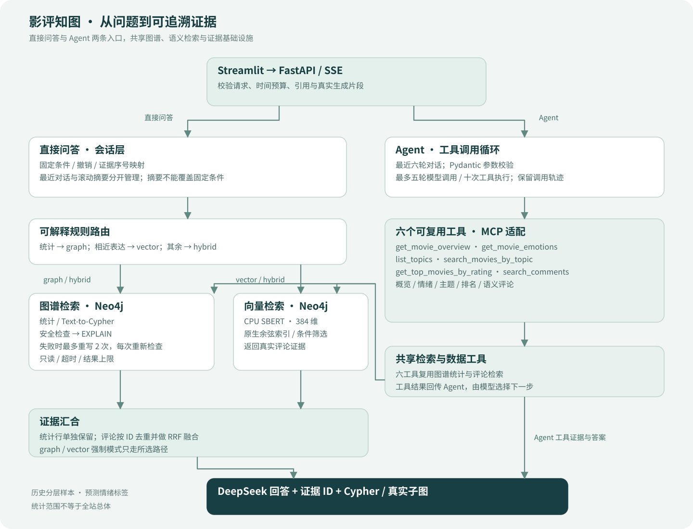

# 影评知图 · Film Review GraphRAG

将影视评论知识图谱、语义检索与工具调用连接成可追溯的问答服务。

**代码供阅读与展示，数据不随仓库提供。** 当前公开导出版本：**1.4.1**。本仓库暂未添加许可证。



上图是文档用静态统计展示，数值来自冻结1.4.1样本参考，没有实时调用模型，也不表示1.4.2效果成绩。图中没有用户名或评论原文。

## 能做什么

- 图谱、向量、融合三路检索与可解释规则路由；统计和评论证据分别保留。
- 六工具Agent、真实生成片段SSE、短期会话条件与引用追溯。
- 只读Cypher检查、EXPLAIN预检、结果上限、超时及工具调用预算。
- Neo4j原生向量索引、Docker Compose、MCP适配和可选Redis缓存/限流。
- 复核工具代码可用；私有回答、评论证据与评分表不随仓库提供。无数据时页面显示空状态。

## 架构



|方式|适合的问题|边界|
|---|---|---|
|graph|数量、排名、比例、分布|从样本库实际计算|
|vector|相近表达、具有某种观点的评论|不能根据少量评论计算全库统计|
|hybrid|统计加评论解释|统计单独保留，评论候选用等权RRF融合|
|auto|希望系统自动选择|固定规则路由，可手动强制模式|

## 已有结果

以下均属于**冻结1.4.1**，不是1.4.2全量成绩。56题各走三路，共168份回答，按人机结合方式评分：

|策略|Y/56|严格完成率|有效回答率|
|---|---:|---:|---:|
|graph|40|71.43%|85.71%|
|vector|5|8.93%|28.57%|
|hybrid|45|80.36%|91.07%|

综合评测共518份：保留123份既有人评、新增30份分层随机人工抽查、接受365份AI评分。它们不是518份独立逐题人工评分；30份抽查也不是独立留出验证。Agent任务54/60完成，三次都成功18/20。

20道独立检索题、132个去重组合经AI评分和用户整批确认：向量/融合候选P@5为36.0%/35.0%，候选池nDCG@5为0.880/0.866。不支持“融合在所有指标上更好”的说法。

原论文76%与这里80.36%的版本、题集及评分来源不同，**不能相减声称提升4.36个百分点**。原论文98%是有效回答率，不能当严格准确率。

详见[实验口径](docs/RESULTS.md)和[聚合JSON](results/v1.4.1/summary.json)。公开题集是脱敏展示/开发用例，不附原始逐题答案或分数。

## 快速开始

建议Python 3.11。首次安装依赖与下载模型需要网络；生成依赖DeepSeek API，不能完全离线运行。

```bash
python -m venv .venv
# 激活虚拟环境后：
python -m pip install torch==2.14.0+cpu --index-url https://download.pytorch.org/whl/cpu
python -m pip install -r requirements-dev.txt
python -m pytest tests -q
```

以上离线单元测试不需要私有数据或API密钥；安装完成后可在离线环境运行。私有数据专用测试会明确跳过，见[测试说明](docs/TESTING.md)。

完整服务需自行准备[规定的数据包](docs/DATA_FORMAT.md)，仅有源码不能启动完整问答。项目未提供数据下载地址，也不承诺任意CSV可直接导入。准备完成后复制`.env.example`为`.env`，设置自己的数据库密码和DeepSeek密钥：

```bash
docker compose up --build -d
```

界面：http://127.0.0.1:18501；API：http://127.0.0.1:18000/docs。`/health`检查进程，`/ready`检查数据库、编码器、模型配置/连通性；就绪探针会请求提供商模型列表。

## 安全设计与局限

密钥只在后端环境配置；生成Cypher逐次执行静态安全检查、范围约束及EXPLAIN只读预检，限制50行、数据库10秒，问答/Agent也有总时限。评论按数据处理，引用必须对应真实证据。READ访问模式本身不是权限控制，详见[安全说明](docs/SECURITY.md)。

- 数据是历史分层样本；情绪来自模型预测，主题不是电影题材标签。
- 自建题集已用于开发，不是外部留出泛化测试。尚未在另一台电脑实测；本机克隆复现也不等于跨机器验证。
- 正式批次没有自然触发重写，尚未观察到自纠错增益；摘要对照也不支持稳定节省token的结论。
- 1.4.2修复多电影范围遗漏，只做定向验证；1.4.1完整成绩继续作为旧版本基线。
- 无鉴权的本机演示配置不能直接视为公网生产配置。向量召回有不相关结果，证据校验覆盖有限，回答仍可能错误。

[使用指南](docs/USER_GUIDE.md) · [数据格式](docs/DATA_FORMAT.md) · [技术变更](docs/CHANGELOG.md) · [脱敏开发记录](docs/开发记录.md) · [发布检查单](docs/public-release/发布检查单.md)
