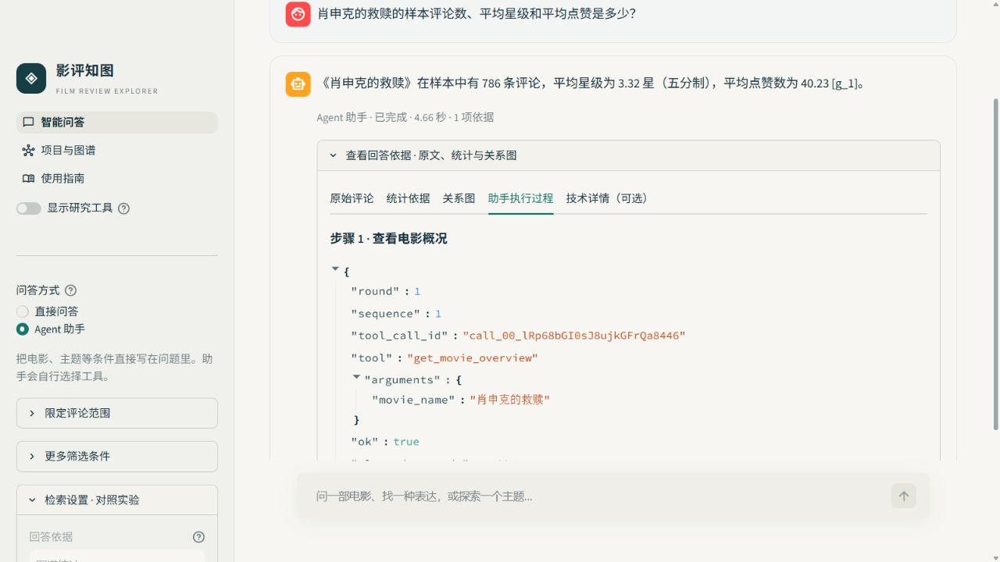

# 影评知图 · Film Review GraphRAG

[](https://github.com/Phoeehnn/film-review-graphrag/actions/workflows/tests.yml?query=branch%3Amain)


**让影评里的观点，变成有据可查的回答。**

基于历史影评构建的知识图谱问答服务：问题自动分流到图谱统计、语义检索或两者融合，回答附带可追溯的 Cypher 查询、统计行或评论证据。

**本科毕业设计扩展版本。** 在原有主题建模、双层情感分析和知识图谱基础上，新增混合检索与规则路由、六工具 Agent、多轮会话、Text-to-Cypher 安全检查与有界自纠错、FastAPI/SSE 服务、Docker 部署和版本化评测。

**技术栈：** Python 3.11 · Neo4j 5（图谱 + 原生向量索引）· Sentence-Transformers · DeepSeek · FastAPI / SSE · Streamlit · Docker Compose · MCP · Redis（可选）· pytest

[真实界面](#真实界面) · [架构与设计](#架构与设计) · [快速开始](#快速开始) · [实验口径](docs/RESULTS.md)

## 主要结果

*冻结 v1.4.1 · 人机结合评测 · [指标来源](results/v1.4.1/summary.json)；当前源码 v1.4.2 的变更另行记录。*

- **融合检索 80.36%，图谱 71.43%**：同一组 56 题强制走三条路径，比较严格完成率。
- **Agent 54/60 任务完成**；20 题中 **18 题连续三次都成功**。这里按最终任务评分统计，不是工具轨迹通过率。
- **短对话追问：带状态 75%–78%，无历史 2.8%**。无历史组本来就缺少上文信息；这是方法组合对照，不能当作旧版准确率或摘要的独立增益。
- **让检索各司其职**：纯向量严格完成率为 8.93%。题集包含大量数量、排名和占比问题，少量相似评论不足以计算整体统计。强制纯向量也不能跨路兜底；这个分数体现本题集上的任务适配边界，不代表所有语义检索任务的质量。

## 真实界面

### 图谱问答：从回答追溯到统计证据


本机 v1.4.2 真实服务截图：展示图谱模式的回答、Cypher 和统计证据。统计描述的是历史分层样本，不代表全站数据；截图仅演示功能，不是新增效果评测。

### Agent：看得见的工具调用



本机 v1.4.2 真实服务截图：电影概览问题调用 `get_movie_overview`，可展开核对工具参数与返回结果。两张截图均不包含评论原文、用户名或本机路径。

## 架构与设计


| 设计 | 做法与用途 |
|---|---|
| 三路检索 | 图谱负责准确统计，向量查找相近表达；融合保留统计行，并对评论候选去重、RRF 排序。 |
| 规则自动路由 | 按问题类型选择路径，规则可解释、可复现；强制模式便于对照。 |
| 六工具 Agent | 模型按需调用工具，参数校验、调用预算及执行记录在服务侧管理。 |
| 多轮会话 | 固定条件、最近对话与摘要分开保存；撤销条件不被旧历史恢复。 |
| 安全查询 | 每次生成或重写都经过静态安全检查和 EXPLAIN；有界重写最多两次。 |
| 服务工程 | FastAPI + SSE 返回真实生成片段；Docker Compose 部署，MCP 复用工具，可选 Redis 缓存及限流。 |

### 怎么选检索方式？

| 方式 | 适合的问题 | 边界 |
|---|---|---|
| `graph` | 数量、排名、比例、分布 | 从样本库实际计算 |
| `vector` | 相近表达、具有某种观点的评论 | 不能根据少量评论计算整体统计 |
| `hybrid` | 统计加评论解释 | 统计单独保留，评论候选用等权 RRF 融合 |
| `auto` | 日常使用，希望系统选择 | 固定规则路由，可手动强制模式 |

复核工具代码保留；不提供私有回答、评论证据或评分表，无数据时显示空状态。

## 快速开始

**代码供阅读与展示，数据不随仓库提供。** 本仓库暂未添加许可证。

建议Python 3.11。首次安装依赖与下载模型需要网络；生成依赖DeepSeek API，不能完全离线运行。

```bash
python -m venv .venv
# 激活虚拟环境后：
python -m pip install torch==2.14.0+cpu --index-url https://download.pytorch.org/whl/cpu
python -m pip install -r requirements-dev.txt
python -m pytest tests -q
```

以上离线单元测试不需要私有数据或API密钥；安装完成后可在离线环境运行。私有数据专用测试会明确跳过，见[测试说明](docs/TESTING.md)。

完整服务需自行准备[规定的数据包](docs/DATA_FORMAT.md)，仅有源码不能启动完整问答。项目未提供数据下载地址，也不承诺任意CSV可直接导入。准备完成后复制`.env.example`为`.env`，设置自己的数据库密码和DeepSeek密钥：

```bash
docker compose up --build -d
```

界面：http://127.0.0.1:18501；API：http://127.0.0.1:18000/docs。`/health`检查进程，`/ready`检查数据库、编码器、模型配置/连通性；就绪探针会请求提供商模型列表。

## 评测说明

<details>
<summary>展开：完整结果、评分来源与比较口径</summary>

综合选集共 **518 份**：保留 123 份既有人评、30 份新增分层随机人工抽查、365 份作者确认接受的 AI 评分。问答采用 DeepSeek 批量初评并由代码助手定向复查；既有人工分数优先保留。**不是 518 份独立逐题人工评分**，抽查样本参与过 AI 复查，也不是独立留出验证。

| 强制策略 | Y / 题数 | 严格完成率 | 有效回答率 |
|---|---:|---:|---:|
| graph | 40/56 | 71.43% | 85.71% |
| vector | 5/56 | 8.93% | 28.57% |
| hybrid | 45/56 | 80.36% | 91.07% |

独立检索组件：20 题、132 个去重组合，由代码助手初评、作者整批确认，不是逐项独立人工评分。向量/融合候选 P@5 为 36.0%/35.0%，候选池 nDCG@5 为 0.880/0.866。未穷尽全库相关集合，不报告全库 Recall，不能据此声称融合在所有指标上更好。

原论文 76% 与这里的 80.36% 在版本、题集和评分来源上不同，不能相减声称提升；原论文 98% 是有效回答率，不能当严格准确率。

详见 [实验口径](docs/RESULTS.md) 与 [聚合 JSON](results/v1.4.1/summary.json)。公开题集是脱敏展示/开发用例，不附原始逐题答案或分数，也不能直接复现私有冻结成绩。

</details>

<details>
<summary>展开：安全设计、适用范围与已知局限</summary>

密钥只在后端环境配置；生成Cypher逐次执行静态安全检查、范围约束及EXPLAIN只读预检，限制50行、数据库10秒，问答/Agent也有总时限。评论按数据处理，引用必须对应真实证据。READ访问模式本身不是权限控制，详见[安全说明](docs/SECURITY.md)。

- 数据是历史分层样本；情绪来自模型预测，主题不是电影题材标签。
- 自建题集已用于开发，不是外部留出泛化测试。尚未在另一台电脑实测；本机克隆复现也不等于跨机器验证。
- 正式批次没有自然触发重写，尚未观察到自纠错增益；摘要对照也不支持稳定节省token的结论。
- 1.4.2修复多电影范围遗漏，只做定向验证；1.4.1完整成绩继续作为旧版本基线。
- 无鉴权的本机演示配置不能直接视为公网生产配置。向量召回有不相关结果，证据校验覆盖有限，回答仍可能错误。

</details>

---

[使用指南](docs/USER_GUIDE.md) · [数据格式](docs/DATA_FORMAT.md) · [技术变更](docs/CHANGELOG.md) · [脱敏开发记录](docs/开发记录.md) · [发布检查单](docs/public-release/发布检查单.md)
