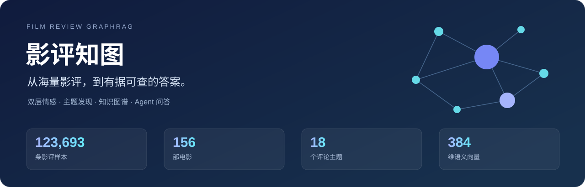
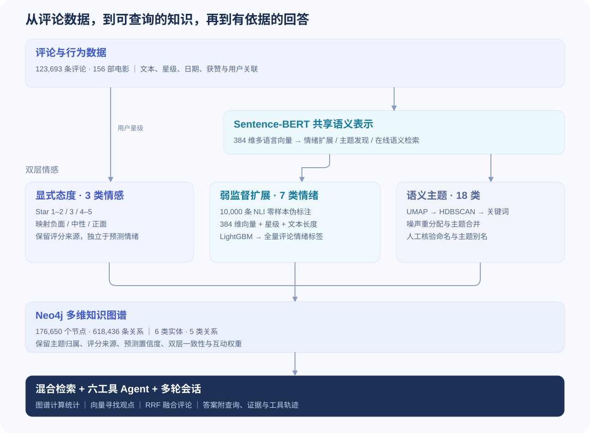
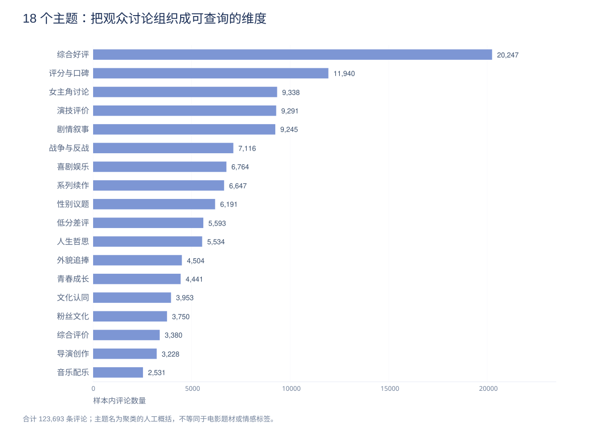
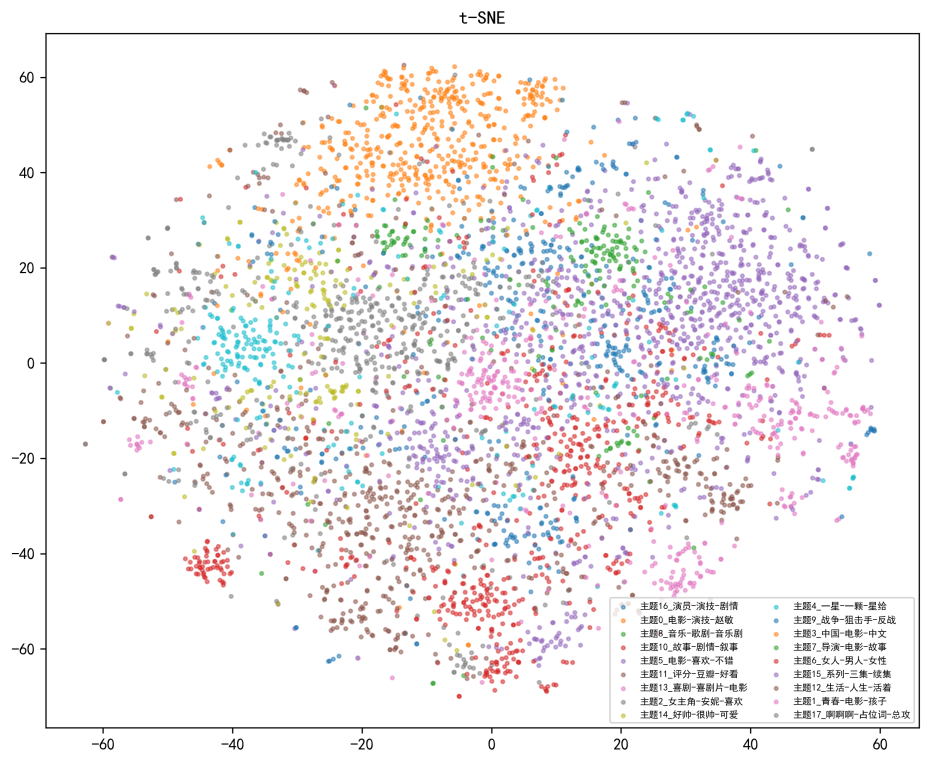
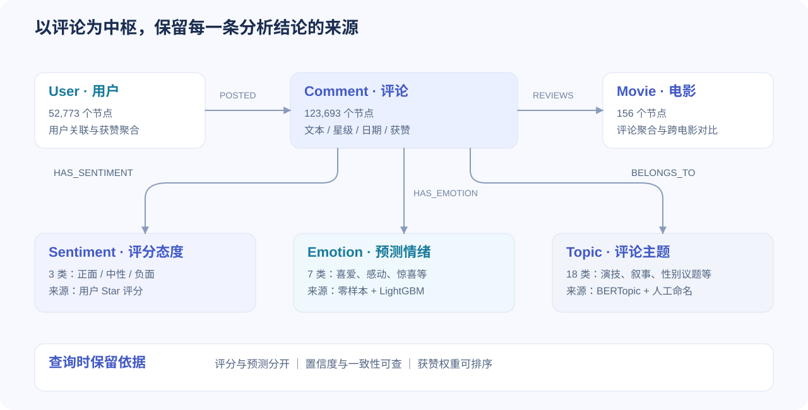
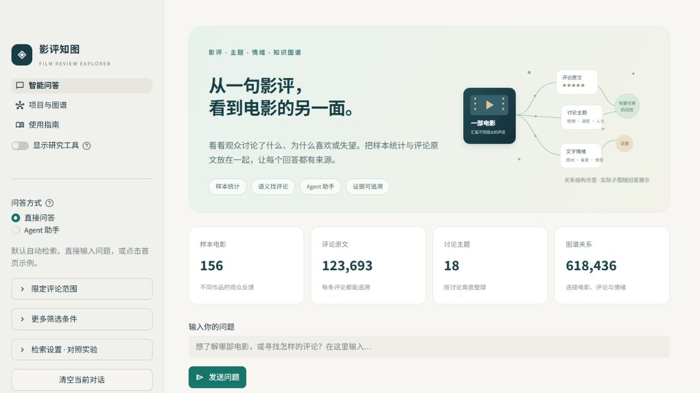

# 影评知图 · Film Review GraphRAG



[](https://github.com/Phoeehnn/film-review-graphrag/actions/workflows/tests.yml?query=branch%3Amain)


**把 12.4 万条影评转化为可分析、可检索、可追溯的知识，让大模型基于真实数据完成问答与工具调用。**

影评知图贯通数据处理、低标注成本的双层情感建模、语义主题发现、多维知识图谱与 Agent 服务。既能分析“观众在讨论什么、态度与情绪有什么差别”，也能通过自然语言完成统计、寻找具体观点、连续追问，并查看查询依据与工具执行过程。

**123,693 条评论 · 156 部电影 · 176,650 个节点 · 618,436 条关系**<br>
**18 个主题 · 3 类评分态度 · 7 类预测情绪 · 384 维共享语义向量**

**效果速览 · 固定题集，人机结合评测：** 融合严格完成率 **80.36%**（图谱 71.43%）；Agent **54/60** 次任务完成，**18/20** 道题连续三次成功。[项目评测](#评测结果)

[核心设计](#核心设计) · [完整技术流程](#完整技术流程) · [应用场景](#应用场景) · [运行界面](#运行界面) · [评测结果](#评测结果) · [本地运行](#本地运行)

## 核心设计

| 设计 | 具体做法与价值 |
|---|---|
| **低标注成本的双层情感建模** | 星级映射保留用户显式态度；对 **10,000 条**评论做 NLI 零样本伪标注，再以 **386 维特征 + LightGBM** 扩展到全量评论，分别表达“给了什么评价”与“文字呈现什么情绪”。 |
| **一次嵌入，多任务共享** | 同一套 **123,693 × 384** 维 SBERT 向量复用于情绪扩展、BERTopic 主题发现与在线语义检索，离线建模产物直接参与在线服务。 |
| **多维信息融合的知识图谱** | 以评论为中枢，把电影、用户关联、**18 个主题**与双层标签组织为 **6 类实体、5 类关系**，保留获赞、预测置信度及一致性信息，支持跨维度查询与证据下钻。 |
| **可解释的检索与推理路径** | 图谱计算数量、比例和排名；向量寻找语义相近的观点；RRF 融合评论候选，统计行单独保留。回答可追溯到 Cypher、统计行、评论 ID 与实际图关系。 |
| **具备执行约束的 Agent 服务** | 六工具调用、严格参数校验、会话条件管理、逐次只读检查与 EXPLAIN、有界重写和调用预算，通过 FastAPI / SSE、Docker Compose 与 MCP 交付。 |

## 完整技术流程



### 双层情感：同时保留评分态度与文本情绪

评分层将 1–2 星、3 星、4–5 星分别映射为负面、中性、正面。情绪层使用 mDeBERTa 的 NLI 零样本分类生成伪标签，以 SBERT 向量、星级和文本长度训练 LightGBM，输出喜爱、感动、惊喜、中性、失望、愤怒、厌恶七类预测。

两层分别存储，支持查询“评分中性、但文字被预测为愤怒”的评论，也保留两层不一致的样本用于核查。**显式评分与预测标签都有来源，模型输出可检查、可替换。**

### 主题发现：把自由表达转化为分析维度

BERTopic 通过 UMAP、HDBSCAN 与关键词表示发现讨论主题，经嵌入相似度重分配、主题合并和人工命名，形成演技评价、剧情叙事、性别议题、战争与反战等 **18 个维度**。模型选型包含 LDA 对照；情绪扩展包含不同模型配置与特征消融。



<details>
<summary>查看主题语义空间</summary>



颜色表示不同主题，二维投影展示评论在语义空间中的分布。[建模方法与参数](docs/MODELING.md)

</details>

### 图谱建模：从聚合结论下钻到证据



例如分析“某电影在剧情叙事主题下的负面评价”，可以沿 `Movie ← Comment → Topic` 定位讨论范围，再通过 `Comment → Sentiment / Emotion` 计算分布，最后按获赞或条件返回对应评论。**同一张图同时支持全样本聚合与评论粒度追溯。**

[建模方法与参数](docs/MODELING.md) · [图谱及服务设计](docs/PROJECT_DESIGN.md) · [公开汇总数据](results/modeling/summary.json)

## 应用场景

围绕电影相似性、争议定位、隐性负面线索、双层一致性、情绪与获赞关联、指定片单对比、用户互动及时间趋势开展 **8 类分析场景验证**。

| 场景 | 关注的问题 | 可核对的依据 |
|---|---|---|
| **口碑诊断** | 负面评价集中在哪些主题？ | 电影 × 主题 × 评分态度的统计及代表评论 |
| **隐性负面线索** | 评分中性的评论中，哪些被预测为负面情绪？ | Star 条件、Emotion 预测、置信度及对应评论 |
| **电影对比与发现** | 哪些电影的讨论结构接近？ | 18 维主题比例余弦、主题与情绪分布 |
| **互动与趋势分析** | 不同情绪的获赞表现、口碑随时间的变化如何？ | 获赞聚合、日期分组及图关系 |
| **语义检索与连续追问** | 找到表达某种感受的观点，再限定电影、主题或情感 | 评论证据 ID、本轮生效条件与查询轨迹 |

以上统计针对历史分层样本，情绪属于模型预测；题材对比采用明确片单，评论主题不充当电影题材标签。[场景与查询路径](docs/PROJECT_DESIGN.md)

## 运行界面



*直接输入问题、点击示例，或切换到 Agent 助手。*

<details>
<summary>查看真实统计问答与 Agent 工具调用</summary>

### 图谱统计


图谱模式的回答与统计依据：样本评论数、平均星级及实际聚合行。

### Agent 工具调用


`get_movie_overview` 的参数、执行状态和证据编号随答案一起保留。

真实运行界面展示统计依据与工具执行轨迹。

</details>

<details>
<summary>查看在线服务架构与执行约束</summary>


- **自动分工**：规则路由选择 graph / vector / hybrid，支持强制模式对照；统计与语义证据保留各自口径。
- **会话状态**：固定条件、历史摘要和真实结果序号分开管理，支持继承、修改与撤销。
- **Agent 执行**：六个工具共享 Pydantic 校验；最多五轮模型调用、十次工具执行，保留工具轨迹。
- **查询约束**：每次生成与重写均检查单句只读、范围、LIMIT 与 EXPLAIN；最多两次重写，查询超时 10 秒。
- **工程交付**：API 与界面分离，SSE 返回真实生成片段；Compose 初始化、MCP 工具复用、可选 Redis 缓存与限流。

[安全设计](docs/SECURITY.md) · [MCP 与 Redis](docs/MCP_AND_REDIS.md)

</details>

## 评测结果


**融合检索兼顾统计与观点，Agent 验证工具执行，多轮会话验证条件继承。** 同一组 56 题中，融合严格完成率为 **80.36%**，图谱为 71.43%；Agent 的 20 道任务各运行三次，其中 **18 道连续三次成功**。

固定题集共 **630 项真实任务**，覆盖检索问答、Agent、查询重写预算及多轮对照；其中 **518 份答案**纳入综合评分，采用 AI 辅助评分与作者审核。另有 **96 项离线检查通过**，覆盖查询安全、范围、会话、SSE 与工具执行。

[项目评测与数据](docs/RESULTS.md) · [可核对的聚合数据](results/v1.4.1/summary.json)

## 技术栈

**建模与知识层：** Sentence-BERT · mDeBERTa / NLI · LightGBM · BERTopic · UMAP · HDBSCAN · LDA · Neo4j 5<br>
**大模型与服务层：** Python 3.11 · DeepSeek · Function Calling · FastAPI / SSE · Streamlit · Docker Compose · MCP · Redis · pytest

## 本地运行

### 运行服务

需要 Docker Desktop，以及 [数据格式](docs/DATA_FORMAT.md) 中的 CSV、评论向量和预处理文件。数据不随仓库提供；代码供阅读与展示，暂未添加许可证。

1. 将 `.env.example` 复制为 `.env`，填入数据库密码与 DeepSeek API 密钥。
2. 放置规定的数据文件。
3. 在仓库根目录执行：

```bash
docker compose up --build -d
```

启动完成后，在**运行 Docker 的这台电脑**打开：

| 入口 | 本机地址 |
|---|---|
| 问答界面 | `http://localhost:18501` |
| API 交互文档 | `http://localhost:18000/docs` |

这些是本地服务地址，不是在线演示站点；未启动服务时无法访问。详细操作见 [使用指南](docs/USER_GUIDE.md)。

### 运行测试

使用 Python 3.11 创建并激活虚拟环境，然后执行：

```bash
python -m pip install torch==2.14.0+cpu --index-url https://download.pytorch.org/whl/cpu
python -m pip install -r requirements-dev.txt
python -m pytest tests -q
```

安装依赖和首次下载模型需要网络；单元测试不调用付费模型。完整问答服务需要 DeepSeek API。[测试说明](docs/TESTING.md)

## 文档

[使用指南](docs/USER_GUIDE.md) · [建模方法](docs/MODELING.md) · [图谱与系统设计](docs/PROJECT_DESIGN.md) · [评测报告](docs/RESULTS.md) · [数据格式](docs/DATA_FORMAT.md) · [查询安全](docs/SECURITY.md)
