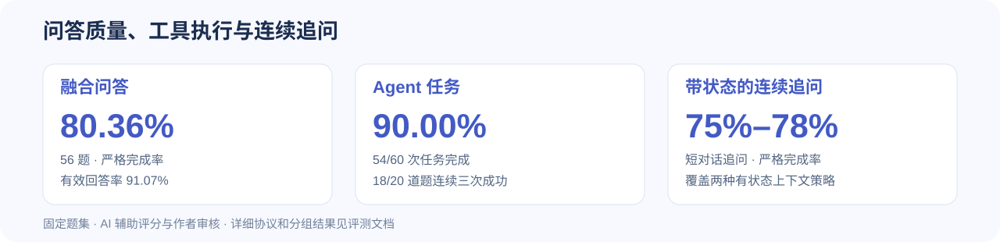

# 项目评测

以固定题集验证问答质量、工具执行与连续追问能力。共完成 **630 项真实任务**，其中 **518 份答案**采用 AI 辅助评分与作者审核形成综合结果。

| 验证目标 | 主要结果 |
|---|---|
| 融合问答 | 56 题，严格完成率 **80.36%**，有效回答率 **91.07%**；同题集图谱严格完成率 71.43% |
| Agent 执行 | **54/60** 次任务完成；**18/20** 道题连续三次成功 |
| 带状态的短对话追问 | 两种有状态上下文策略的严格完成率 **75%–78%** |
| 工程验证 | **96 项**离线检查通过，覆盖查询安全、范围筛选、会话、SSE 与工具执行 |

严格完成率为 Y/总数，有效回答率为 (Y+P)/总数；Agent 按任务完成与否评分。评分保留既有人评，并结合 AI 初评、人工抽查与作者确认。

[聚合数据与批次元信息](../results/v1.4.1/summary.json)保留各分组计数、评分来源与实验配置，便于核对。运行和测试方法见[测试说明](TESTING.md)。
